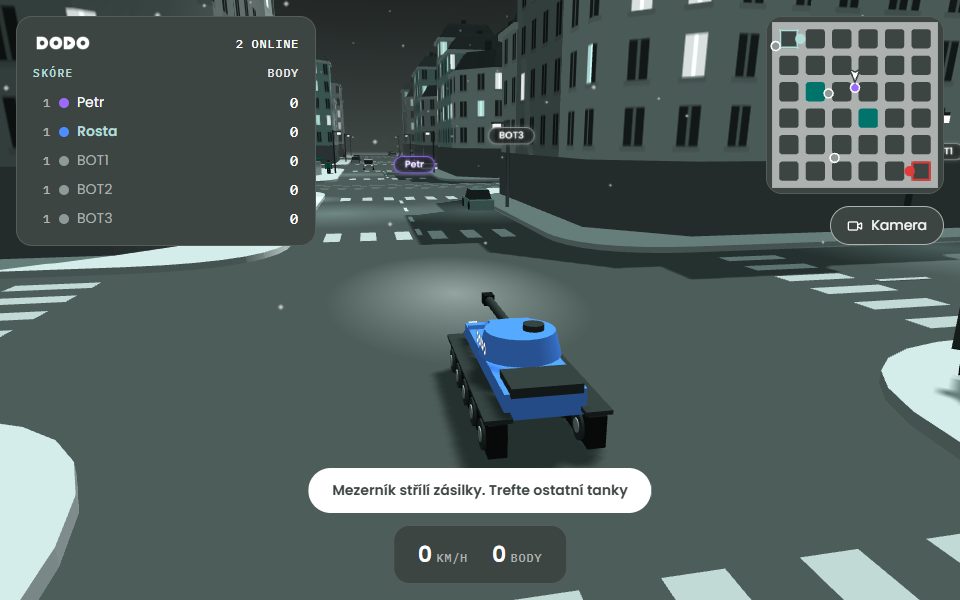

# World of DODO

A small multiplayer tank, plane and ship game in the browser. One snowy city, two teams, everybody in their own
DODO tank, plane or warship, parcels for ammunition. The city is **Karlín, a real district of Prague**, built from open map data:
its streets, houses, the tram on Sokolovská, the Negrelli viaduct and the hill of Vítkov. Built on *Poslední míle* (The
Last Mile), the 3D delivery game DODO made for Christmas 2026, where the delivery van had already turned into a tank.

**Play: https://game-3a26-3000.prg1.zerops.app** (English: add `?lang=en`)



- **Join with a name only.** Pick a name, a colour, a team (or let the game pick one) and a tank, a plane or a
  ship, and go. No account, no password, nothing is stored: your score lasts as long as you stay connected.
- **Two teams, A and B.** Team A's home is the west of Karlín (the Negrelli viaduct), team B's the east (Forum
  Karlín); you come in on your team's side. The game keeps the teams even (you may pick one, as long as it
  has no more than one person more than the other). Teammates cannot hurt each other. Your team shows on
  the name tags, the scoreboard, the minimap and a little flag on every vehicle.
- **Every vehicle wins points for its team in its own way**, and they all add up to the team's score:
  - **tanks capture the three ground zones**, Viadukt, Náměstí (by the church on Karlínské náměstí) and
    Forum: every tank inside pushes the zone towards its team (at most three of a team count, the two
    sides cancel out), and a zone a team owns gives it **1 point a second**;
  - **ships capture the river zone** on the Vltava north of Karlín, the same way, 1 point a second;
  - **planes bomb the other team's supply depots**, four in each team's half (fuel tanks and crates): three
    parcels destroy one, **30 points**, and it is rebuilt 90 s later. A tank's parcels and a ship's shells
    destroy them too (a few stand close enough to the river for the ships' guns);
  - **every hit scores** as below.
  - and personally: every tank (ship) inside a zone when its team takes it gets **10 points**, and whoever
    destroys a depot gets its 30, so a bomber shows on the scoreboard as much as a gunner.
- **Rounds.** A round ends when a team reaches **1000 points** or after **15 minutes** (the higher score
  wins). 15 s later a new round begins from nothing, the teams evened out.
- **Shoot the others.** In a tank, Space (or the green button on a phone) fires a parcel and E the
  anti-aircraft gun, which aims itself at the nearest plane. A parcel in a player's tank of the other team
  is worth **10 points**; a hit on a bot (BOT1, BOT2, …) half of what it is worth on a person (a parcel in a
  bot's tank 5).
- **Fly.** A plane flies where the mouse points, as in War Thunder's arcade "mouse aim": click into the
  game, move the mouse, W and S for the throttle, Space or the left button for the guns, E (or the right
  button) drops a parcel on the tanks below. The arrow keys fly it too. Climb too steeply and it stalls;
  the ground, a building or a tree end the flight; the airspace reaches far beyond Karlín, over the
  Vltava, Holešovice and Letná and up the hill of Vítkov (fly low and you hit it), and the plane turns
  back at its edge.
- **Sail.** A ship is a small DODO destroyer on the Vltava, which is liquid now and runs under the
  bridges north of the city. W and S move the engine telegraph a step (astern, stop, 1/3, 2/3, full) and
  the ship gathers speed slowly; A and D put the rudder over, and it turns the faster the faster it goes.
  Click into the game and the mouse turns the camera round the ship: its two twin turrets traverse
  towards where the middle of the view points (the card at the bottom says which are on target), the
  left button fires a salvo from every turret on target and loaded (the shells fly an arc, about 320 at
  most, and the farther the wider they scatter), the right button or Shift looks through the
  binoculars, Q launches three torpedoes from the side facing the aim, E fires the anti-aircraft guns.
  The banks and the bridge piers stop it, so does another ship. Tanks on the embankment and planes
  reach it too, and its guns reach the streets along the river.
- **Damage adds up.** Three parcels or twelve bullets destroy a tank, one parcel or six bullets a plane,
  nine shells or two torpedoes a ship (its hits add up over 20 s, a tank's and a plane's over 8),
  and every hit scores its share: a bullet is 3 points in a tank, 5 in a plane; a shell is 10 in a
  tank, 4 in a ship, a torpedo 15. A destroyed vehicle comes back somewhere else (a ship sinks first),
  blinking and immune for a few seconds; V switches between tank, plane and ship (while destroyed, 1, 2
  or 3 picks the next one).
- **Back to the menu.** Esc (or the Menu button on a phone) leaves the game for the start screen, where
  the name, the colour and the vehicle can be changed; the tab stays open, and the start button joins
  again. In a plane or a ship the first Esc only lets the mouse go (the browser's rule), the second one
  leaves.
- **The bots** are driven by the server and fill both teams up to six (a person who comes in takes a
  bot's place). Each team has a bot plane and a bot ship (unless one of its people flies or sails one), the
  rest are tanks. The tanks drive Karlín's real streets to the zones and capture them, fight the other
  team's tanks and ships, and fire short bursts at a plane that flies low over them; the planes bomb the
  depots and fight the other team's planes; the ships hold the river zone and fight the other ships with
  their guns, torpedoes and anti-aircraft guns. They fly and sail the players' own planes and ships and
  make mistakes on purpose: they can be beaten.
- **A construction site** (off for now): sand piles, barriers, machines, a tower crane, a half-built
  house and a container yard, all of it cover. Karlín's empty lots are too small for it, so it waits
  for a real building site in Karlín (#17, `SITE_LOT` in client/shared/map.ts).
- **A shared city.** The cars, the tram and the pedestrians are the same for everyone. Tanks shove cars
  about as in the original game, and everyone sees the car fly. A pedestrian a tank or a parcel knocks
  down lies there for a while, then is gone and walks again somewhere else.
- **Names only in plain sight.** A tank's name glows above it only while nothing stands between you,
  and it shows on the minimap only once you have spotted it. The scoreboard lists everybody.
- **Runs on modest hardware.** The quality drops by itself when the frames do not keep up; F shows
  FPS, ping and the level, Q changes the level by hand (not in a ship, where Q launches torpedoes).
- Czech by default, English with `?lang=en`. Works on phones (touch controls).

## Našli jste chybu nebo máte nápad?

Pro hráče, bez programování:

1. Otevřete **[nové hlášení](https://github.com/Rajcze33/world-of-dodo/issues/new/choose)**. Potřebujete
   účet na GitHubu, je zdarma. Ze hry se sem dostanete odkazem na úvodní obrazovce.
2. Vyberte **Chyba**, když něco nefunguje, nebo **Nápad**, když chcete něco přidat či změnit.
3. Vyplňte formulář a odešlete ho. Snímek obrazovky vložíte přes Ctrl+V; když se hra seká, přidejte,
   co ukazuje klávesa F.

Hlášení se samo objeví na **[tabuli](https://github.com/users/Rajcze33/projects/1)** ve sloupci
*Nápady*. Co se bude dělat, se přesune do *Na řadě*, pak do *Dělá se* a nakonec do *Hotovo*: na tabuli
tak vždycky vidíte, co se s vaším hlášením děje.

*In English: report bugs and ideas with the [issue forms](https://github.com/Rajcze33/world-of-dodo/issues/new/choose);
the [board](https://github.com/users/Rajcze33/projects/1) shows what is being worked on.*

## Play it locally

With Docker:

```sh
docker compose up --build -d
# open http://localhost:3400 in two browser windows
```

Or with Node.js 24:

```sh
npm ci
npm run build      # the game page: client/ → client/dist
npm start          # http://localhost:3000
```

While working on the game page, `npm run dev` serves `client/` with live reload on
http://localhost:5173 and passes the game's WebSocket to `npm start` (run both).

## The map: the real Karlín

The city is Karlín as it is, from open data, generated into one file, `client/shared/karlin.json`
(never edited by hand):

- the buildings (footprints, heights, roofs), the streets, the tram and railway lines, squares, parks,
  trees, water and landmarks from **[OpenStreetMap](https://www.openstreetmap.org/copyright)**
  (ODbL);
- the number of floors of every house from **IPR Praha**, *Podlažnost budov* (CC BY 4.0);
- the terrain around Karlín (Vítkov, Letná, the river bed) from **ČÚZK**, *DMR 5G* (CC BY 4.0).

No Google, Mapbox, Apple, Esri or Mapy.com content is used. The game shows the three attributions,
"© OpenStreetMap contributors (ODbL)", "datový podklad © IPR Praha (CC BY 4.0)" and "výškopis © ČÚZK
(CC BY 4.0)".

One game unit is 1.5 m, the houses are 1.2 times their real height (a bit of a cartoon), and the map is
turned by 17° so that Karlín's streets run along the axes. The tanks, bots and cars stay in the
**arena**, about 1 km × 630 m from the Negrelli viaduct to Forum Karlín and from the Vltava embankment
to the railway at the foot of Vítkov; the planes fly over a square of about 2 km round it.
[client/shared/KARLIN-DATA.md](client/shared/KARLIN-DATA.md) describes the data, what was simplified
and the known problems; [tools/karlin/README.md](tools/karlin/README.md) says how to make it again:

```sh
node tools/karlin/gen.mjs            # from the cached downloads (add --refresh to download OSM, IPR and ČÚZK again)
node tools/karlin/check.mjs          # check the file
```

## How it works

```
client/index.html   the page: HUD, intro screen, touch controls (markup and styles)
client/src/         the game in TypeScript on Babylon.js, built by Vite into client/dist:
  core/             engine, scene, lights and shadows, geometry, materials, textures
  world/            drawing Karlín: buildings, streets, landmarks, props, traffic and tram, pedestrians, the land
                    around; grid.ts is the world as the game code asks for it
  game/             the player's tank, plane and ship, parcels, bullets, shells and torpedoes, effects, input, quality levels
  net/              the other players and the shared city from the server
  ui/               HUD and minimap;  main.ts: the frame loop and the join form
client/shared/      the world, written once and run by the page and the server alike: map.ts (the solids,
                    the ground, the street graph, spawn points; from karlin.json), geom.ts, site.ts (the
                    construction site), naval.ts (the river), rules.ts (the teams, zones, depots and their
                    numbers), the traffic, tram and pedestrian code
server/server.js    serves the built page, relays the players over a WebSocket, keeps the score and the teams
server/game.js      the team game: team scores, zones, depots, rounds (the rules: client/shared/rules.ts)
server/bots.js      the bots: the tanks (driving the street graph, aiming), and what happens when something hits one
server/planebot.js  the plane bots (the players' flight model);  server/shipbot.js: the ship bots
server/shots.js     what the server flies: the people's shots at the bots, everything the bots fire
server/world.js     the shared city life: cars, tram, pedestrians, knocked-down trees and lamps
server/city.js      the map for the server (client/shared/map.ts, which Node 24 runs as it is)
tools/karlin/       the map's generator (OpenStreetMap, IPR Praha, ČÚZK → client/shared/karlin.json)
docs/PROTOCOL.md    every message between the browser and the server
```

The server does not simulate the players. Each browser drives its own tank or flies its plane and
sends where it is, 20 times a second; the server sends everyone back in one snapshot. A fired parcel
or bullet is passed on, and every browser flies it. **The player who gets hit by a parcel decides the
hit**, because on that screen their tank is exactly where it is; **a bullet's shooter decides** (a fast
plane would be out of reach otherwise), and the server passes the hit on. The server awards the points. The bots and the life
of the city (cars, tram, pedestrians) run on the server, so everyone sees the same city, and the
server decides what hits a bot. **The server keeps the team game**: the zones, the depots (a browser says
where its parcel, shell or bullet hit one, the server checks it), the team scores and the rounds. **A car a tank shoves is that player's** until it comes to rest: their
browser moves it and the server passes it on.

Every row of a snapshot carries the moment it shows on the server's clock, and the browsers draw the
others a fixed 150 ms behind that clock, between two rows (snapshot interpolation, as most network games
do it), so the network's jitter does not show. [docs/PROTOCOL.md](docs/PROTOCOL.md) has the details.

The game page is TypeScript on [Babylon.js](https://www.babylonjs.com/), built with Vite
(`npm run build`; the server sends `client/dist`). The scene is right-handed like the three.js
original it was ported from (x east, z south, y up). The fonts and images are in `client/public`.
The first load is about 1.3 MB of compressed script (Babylon.js and the map of Karlín), sent as brotli or gzip.
The server loads the same `client/shared` TypeScript directly: Node 24 strips the types, so that code
uses only erasable TypeScript (no enums, namespaces or parameter properties) and imports with `.ts`.

## Configuration

Environment variables of the server:

| Variable | Default | |
| --- | --- | --- |
| `PORT` | `3000` | HTTP and WebSocket port |
| `TEAM_SIZE` | `6` | members of a team: bots fill each team up to it, people counted (1–16); they play only while at least one person is in |
| `MAX_PLAYERS` | `24` | people at once; the bots come on top |
| `ROUND_POINTS` | `1000` | the points that win a round (for tests) |
| `ROUND_SEC` | `900` | a round's length in seconds (for tests) |

## Tests

```sh
npm run check          # TypeScript: the whole game page and client/shared type-check
npm run smoke          # protocol test against a running server (default http://localhost:3400)
npm run test:browser   # two players in headless Chrome; needs Chrome and: npm i --no-save puppeteer-core@25.14.0
node tools/test-map.ts # the shared map core (client/shared/map.ts): collisions, ground, street graph, spawns
```

The smoke and browser tests take their places (spawn points, a street for a duel, a house's wall) from
the map itself, so run them against a server of the same version. The smoke test plays a whole round
(its team scores up to the round's points, `ROUND_POINTS`), so run it against a server nobody plays on; it
takes about two and a half minutes.

There is no CI on purpose: it is a game for fun, and a push to `main` goes straight to the server
(see Deploy). Run the checks yourself before you push.

## Deploy (Zerops)

The game runs as a Zerops project of its own: one Node.js service with one container, because every
player has to reach the same process.

```sh
zcli project project-import zerops/import.yaml --org-id <organisation>   # once: the project and the service
zcli service enable-subdomain --project-id <project> --service-id <service "game">   # once, after the first deploy
```

**Every push to `main` deploys** (a merged pull request too), in about two minutes: the service `game`
is connected to this repository in the Zerops GUI (Pipelines & CI/CD settings, GitHub, trigger *Push
to branch* `main`), and Zerops builds with `zerops.yaml` from the repository. A push that must not
deploy carries `[skip ci]` in its commit message. By hand, from the repository root:
`zcli push --project-id <project> --service-id <service "game">` (on Windows from a folder outside
OneDrive, e.g. a `git archive HEAD` copy: OneDrive's placeholder files break zcli's archive).

The WebSocket runs over the same HTTPS port (`/ws`), nothing else to open.

## Known limits

- **The clients are trusted.** A modified browser can lie about its own tank or plane or report hits.
  It is a game for fun, not a tournament.
- A plane needs a mouse (or the arrow keys); on a phone it flies with the steering pad, which is
  clumsier. A ship on a phone: the pad is the rudder, the arrows the telegraph, a finger dragged over the
  game turns the camera, the green button fires and the one above it launches the torpedoes; its
  anti-aircraft guns fire by themselves when a plane comes close.
- What you see of the others is 150 ms old, plus the network's delay: a tank you ram is where it was a
  moment ago on its owner's screen. A car somebody else is pushing does not give way to you until they
  let go of it.
- One server is one world. More players than `MAX_PLAYERS` wait outside.
- The supply depots do not stop a tank (it drives through them); the bots never ram anybody, and a ship
  bot is not hurt by a person's ship ramming it.

## Contributing

Found a bug or have an idea? [Open an issue](https://github.com/Rajcze33/world-of-dodo/issues/new/choose)
(the **Chyba** or **Nápad** form); what is being worked on is on the
[board](https://github.com/users/Rajcze33/projects/1). Pull requests are welcome, see
[CONTRIBUTING.md](CONTRIBUTING.md); AI coding agents read [AGENTS.md](AGENTS.md).

## License

The code is under the [MIT License](LICENSE). Third-party parts (three.js, the fonts) keep their own
licenses, see [THIRD_PARTY.md](THIRD_PARTY.md). The map data, `client/shared/karlin.json`, is a database
derived from OpenStreetMap and is under the [ODbL](https://opendatacommons.org/licenses/odbl/) (© OpenStreetMap
contributors), with data © IPR Praha and © ČÚZK (CC BY 4.0); see
[client/shared/KARLIN-DATA.md](client/shared/KARLIN-DATA.md). The DODO name and logo are trademarks of
DODO and are not covered by the MIT License.
